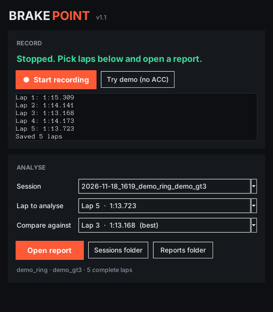

# BrakePoint

**Find out where you lose time under braking in Assetto Corsa Competizione, and why.**

BrakePoint records your laps in ACC and compares any lap with your best one. You get a clear report showing every braking zone, how much time it cost you, and what you did differently.


## What it tells you

For every braking zone:

- **Time lost or gained** compared with your best lap
- **Brake point**: did you brake earlier or later?
- **Brake pressure**: did you hit the pedal as hard?
- **Minimum speed**: did you carry as much speed to the apex?
- **Throttle**: how much later were you back to full throttle?
- **Entry vs exit**: whether the time went before or after the apex

The **track map** is coloured by where you gain (green) and lose (red) time. Click any zone or any point on the map to zoom straight in.


## Download (Windows)

1. Go to **[Releases](../../releases)** and download **`BrakePoint.exe`**.
2. Put it in its own folder, e.g. `C:\BrakePoint`. Your sessions and reports are saved next to it.
3. Double-click it. No Python or install needed.



**Using it:**

- Click **Start recording**, then drive in ACC. Each lap appears as you cross the line. Click **Stop** when you're done.
- Under **Analyse**, pick the lap to analyse and the lap to compare it against (your best is picked for you), then click **Open report**.
- No ACC to hand? Click **Try demo** to record fake laps and see a report.

> Windows may show a "Windows protected your PC" warning the first time, because the exe isn't code-signed. Click **More info → Run anyway**. The full source is right here if you'd rather run it with Python.

The first out-lap and any laps where you visit the pits are skipped automatically.

## Run from source (Python)

1. Install [Python 3.10+](https://www.python.org/downloads/) and tick **"Add Python to PATH"**.
2. Run `install.bat` once, then `python brakepoint_app.py` for the app.

Or use the command line:

```
python recorder.py                     # record (Ctrl+C to stop)
python analyze.py                      # last lap vs your best
python analyze.py --lap 5 --ref 3      # lap 5 vs lap 3
```

To build the exe yourself, run `build.bat`. It creates `dist\BrakePoint.exe`.

## How it works

| File | What it does |
|---|---|
| `brakepoint_app.py` | The desktop app (what `BrakePoint.exe` runs): record, stop, pick laps and open reports. |
| `acc_shm.py` | Reads ACC's shared memory, the same live data feed tools like SimHub use. Read-only and Windows only. |
| `recorder.py` | Samples speed, pedals, gear and car position 60 times a second and saves each completed lap. |
| `analyze.py` | Lines laps up by track position, detects braking zones on the reference lap, and measures the time delta, brake point, minimum speed and throttle pickup for each one. |
| `report_template.html` | The interactive report: speed, delta and pedal traces, a track map, and zone cards. A single self-contained file that works offline. |
| `mock_session.py` | Generates fake laps on a made-up circuit, and replays them as a fake ACC for the app's demo mode. |
| `.github/workflows/build-exe.yml` | Builds `BrakePoint.exe` on GitHub's Windows servers and attaches it to each release. |

**Why line laps up by track position and not by time?** Two laps reach the same corner at different times. Comparing by position along the track makes sure you're always comparing the same piece of tarmac. The time delta at each point is then simply the difference in elapsed time.

## Roadmap

- [x] Desktop app with lap picker (v1.1)
- [ ] Switch laps inside the report itself
- [ ] Live mode: delta to your best braking point on a second screen while driving
- [ ] Corner names for each track
- [ ] Compare against another driver's lap file
- [ ] Overlay both racing lines on the map

## Requirements

- Windows (ACC's shared memory is Windows only)
- Python 3.10+
- numpy

## Author

Built by a sim racer who wanted to know exactly where the time was going. Feedback and bug reports are welcome. Open an issue.

© 2026 All rights reserved.
