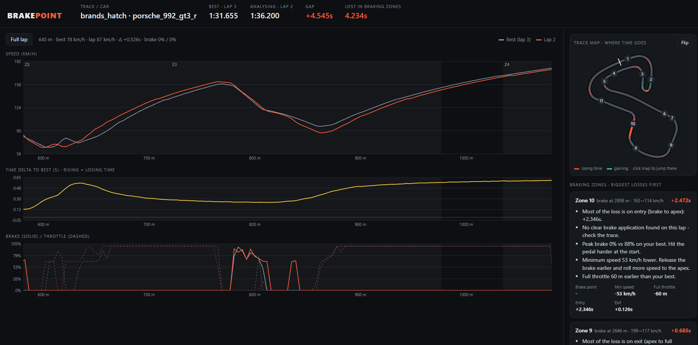
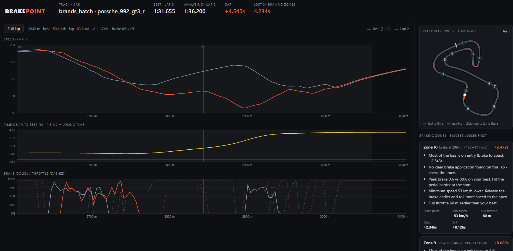

# BrakePoint

**Find out where you lose time under braking in Assetto Corsa Competizione, and why.**

BrakePoint records your laps in ACC and compares any lap with your best one. You get a clear report showing every braking zone, how much time it cost you, and what you did differently.



## What it tells you

For every braking zone:

- **Time lost or gained** compared with your best lap
- **Brake point**: did you brake earlier or later?
- **Brake pressure**: did you hit the pedal as hard?
- **Minimum speed**: did you carry as much speed to the apex?
- **Throttle**: how much later were you back to full throttle?
- **Entry vs exit**: whether the time went before or after the apex

The **track map** is coloured by where you gain (green) and lose (red) time. Click any zone or any point on the map to zoom straight in.



## Quick start (Windows)

1. Install [Python 3.10+](https://www.python.org/downloads/). On the first installer screen, tick **"Add Python to PATH"**.
2. Download this repo (green **Code** button → **Download ZIP**) and unzip it.
3. Double-click **`install.bat`** (one time only).
4. Double-click **`record.bat`**, then go and drive in ACC. Close the window when you're done.
5. Double-click **`analyze.bat`**. Your report opens in the browser.

The first out-lap and any laps where you visit the pits are skipped automatically.

### Command-line options

```
python analyze.py                      # last lap vs your best
python analyze.py --lap 5              # lap 5 vs your best
python analyze.py --lap 5 --ref 3      # lap 5 vs lap 3
python analyze.py sessions/<file>.json # an older session
```

Sessions are saved in `sessions/` and reports in `reports/`.

**No ACC to hand?** Run `python mock_session.py` to generate a demo session, then run `analyze.bat`.

## How it works

| File | What it does |
|---|---|
| `acc_shm.py` | Reads ACC's shared memory, the same live data feed tools like SimHub use. Read-only and Windows only. |
| `recorder.py` | Samples speed, pedals, gear and car position 60 times a second and saves each completed lap. |
| `analyze.py` | Lines laps up by track position, detects braking zones on the reference lap, and measures the time delta, brake point, minimum speed and throttle pickup for each one. |
| `report_template.html` | The interactive report: speed, delta and pedal traces, a track map, and zone cards. A single self-contained file that works offline. |
| `mock_session.py` | Generates fake laps on a made-up circuit for testing. |

**Why line laps up by track position and not by time?** Two laps reach the same corner at different times. Comparing by position along the track makes sure you're always comparing the same piece of tarmac. The time delta at each point is then simply the difference in elapsed time.

## Roadmap

- [ ] Choose laps inside the report instead of on the command line
- [ ] Live mode: delta to your best braking point on a second screen while driving
- [ ] Corner names for each track
- [ ] Compare against another driver's lap file
- [ ] Overlay both racing lines on the map

## Requirements

- Windows (ACC's shared memory is Windows only)
- Python 3.10+
- numpy

## Author

Built by a sim racer who wanted to know exactly where the time was going. Feedback and bug reports are welcome. Open an issue.

© 2026 All rights reserved.
